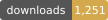

<h1 align="center">Lyorune</h1>

<em>The light that guides every healer</em>

<a href="https://github.com/BellaHealFr/Lyorune/releases/latest"><strong>Download</strong></a> ·
<a href="https://www.curseforge.com/wow/addons/lyorune-healing">CurseForge</a> ·
<a href="https://addons.wago.io/addons/lyorune">Wago</a> ·
<a href="https://www.wowinterface.com/downloads/info27323-Lyorune.html">WoWInterface</a> ·
<a href="https://bellahealfr.github.io/Lyorune/en/">Website</a> ·
<a href="docs/GUIDE.en.md">Player guide</a> ·
<a href="docs/SIGNALER_UN_BUG.md#reporting-a-bug-english">Report a bug</a> ·
<a href="README.md">Version française</a>

---

The tank who survives by a miracle. The mage who "just wanted to see". The heal that lands at the very last second, and the whole group breathing again. **Those are the moments we play healers for.**

Lyorune is a set of healing frames for **World of Warcraft: Forever**: your whole group in front of your eyes, all your spells under your fingers. You click, it heals. The rest of the time, you enjoy the dungeon, your friends and the journey.

Easy to set up, light in combat, pleasant to look at. I made it for everyone who loves watching over others.

<table>
<tr>
<td align="center" width="25%"> <strong>HEAL</strong> with precision</td>
<td align="center" width="25%"> <strong>PROTECT</strong> your allies</td>
<td align="center" width="25%"> <strong>ANTICIPATE</strong> every threat</td>
<td align="center" width="25%"> <strong>BECOME</strong> indispensable</td>
</tr>
</table>

<!-- captures:debut -->
## Screenshots

<table>
<tr>
<td width="50%" align="center"> <em>Lyorune frames: health, mana, heals and role at a glance</em></td>
<td width="50%" align="center"> <em>The options: every setting has its checkbox</em></td>
</tr>
</table>
<!-- captures:fin -->

## What Lyorune does for you

| | |
|:-:|---|
|  | **Heal with one click** : every click casts the spell and rank of your choice, no targeting. |
|  | **Everything at a glance** : health, incoming heals, shields, mana, threat and range, even in combat. |
|  | **Dispel without searching** : the frame lights up when you can remove a debuff. |
|  | **Resurrect with the same click** : on a dead player, your heal click casts your resurrection. |
|  | **Your style** : five themes, four cell shapes, every element placed as you like. |
|  | **Test mode** : a fake group of 5 to 40 players to tune everything in peace. |
|  | **Easy to set up** : twelve chapters and a preview cell showing every setting live. |
|  | **Nothing is mandatory** : every element has its checkbox. |

**[All features in detail](docs/FEATURES.en.md)**

Lyorune never changes the game's frames or other addons' frames: it runs alongside ElvUI, Clique and your other interface addons.

## The runes of Lyorune

At the bottom of the options window, a line of golden runes lights up from time to time, from left to right.

**What they say:**

> *"Whomsoever takes up this blade shall wield power eternal."*

It is the inscription carved on Frostmourne's dais, the one Muradin reads to Arthas in Warcraft III. Everyone who grew up with Warcraft remembers it: the moment everything changes.

**How to read them:** each rune stands for one letter of the sentence. They are the runes of the Elder Futhark, a very real alphabet used almost two thousand years ago. The sounds "th" and "ng" are written with a single rune.

In game, hover the runes: they light up and their translation appears. If they distract you, a checkbox removes them (Window and help chapter).

## Installation

1. Download the latest version from the [Releases](https://github.com/BellaHealFr/Lyorune/releases/latest) page, from [CurseForge](https://www.curseforge.com/wow/addons/lyorune-healing) (project "Lyorune Healing"), from [Wago](https://addons.wago.io/addons/lyorune) or from [WoWInterface](https://www.wowinterface.com/downloads/info27323-Lyorune.html), all updated at the same time. These are the only four official sources (see [SECURITY.md](SECURITY.md)). With the CurseForge or Wago app, updates install on their own.
2. Unzip it into `World of Warcraft\_forever_\Interface\AddOns\`. You should get a `Lyorune` folder.
3. Start the game. A one-minute tutorial opens on first login, and off you go.

## Getting started

No group at hand? Type `/lyorune test`: a fake group appears, with its wounded players and debuffs, so you can try your clicks and tune the look at your own pace.

| Command | Effect |
|---|---|
| `/lyorune` | Open the options |
| `/lyorune test` | Show or hide the fake group |
| `/lyorune tuto` | Restart the tutorial |
| `/lyorune verrou` | Lock or unlock the frames' position |
| `/lyorune bug` | Report a problem |

The full player guide is in [docs/GUIDE.en.md](docs/GUIDE.en.md). In game, everything is in English when your game is: options, guided tour, news and chat messages.

## Something wrong? Tell me

Every report makes Lyorune better for everyone. In game, type `/lyorune bug`, answer the three questions, copy the report (Ctrl+C) and paste it into the [English bug form](https://github.com/BellaHealFr/Lyorune/issues/new?template=bug_en.yml). Issues written in English are welcome. A step by step guide is in [docs/SIGNALER_UN_BUG.md](docs/SIGNALER_UN_BUG.md#reporting-a-bug-english).

An idea, a wish? The [idea form](https://github.com/BellaHealFr/Lyorune/issues/new?template=idee_en.yml) is there for that.

## Compatibility

World of Warcraft: Forever, interface 16001. Languages: French and English. No dependency.

## Documentation

| Document | For whom |
|---|---|
| [Player guide](docs/GUIDE.en.md) | Using and tuning Lyorune |
| [Reporting a bug](docs/SIGNALER_UN_BUG.md#reporting-a-bug-english) | Step by step, no technical knowledge needed |
| [Changelog](CHANGELOG.en.md) | What changes in each version |

## Who am I?

I am **BellaDroode**, and I am in love with World of Warcraft: a magical world where loneliness has no place.

Lyorune grew out of that idea. Behind every health bar I see a companion, and healing means watching over them. I created this addon to keep that gesture simple, fast and beautiful.

If Lyorune travels with you in dungeons or raids, a star at the top of this page will always make my day. Have fun, and happy healing!

## Come and play with me

I play in the guild **La Taverne Nocturne**: a relaxed, French-speaking PvE guild that raids after 10 pm (Paris time). *When the world falls asleep, our adventures begin.*

On our [Discord server](https://discord.gg/uRaEPTGePu), you can find me to chat, play together or talk about Lyorune: a section is dedicated to it.

## License

Copyright © 2026 BellaDroode. All rights reserved.

You may use Lyorune and share it for free as is. You may not distribute a modified version, rename it, remove the author's name or sell it. The full text is in [LICENSE](LICENSE) (French, with an English summary).

**The code is visible, it is not free to reuse.** Like any World of Warcraft addon, Lyorune's code must stay readable by the players who install it; that grants no right to reuse it. If you see a renamed or modified copy of Lyorune, or one published under another author's name, please [report it](https://github.com/BellaHealFr/Lyorune/issues/new/choose).

World of Warcraft and Blizzard Entertainment are trademarks of Blizzard Entertainment, Inc. Lyorune is an independent project. The runic inscription in the options window quotes a line from Warcraft III, as a tribute.
