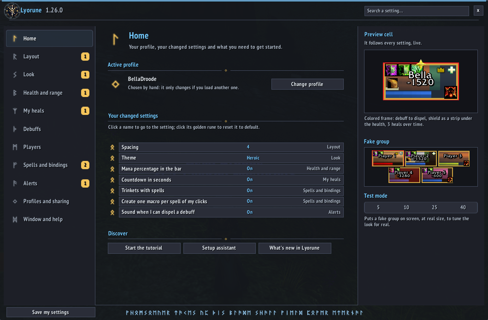

<h1 align="center">Lyorune</h1>

<em>The light that guides every healer</em>

<a href="https://github.com/BellaHealFr/Lyorune/releases/latest"><strong>Download</strong></a> ·
<a href="https://www.curseforge.com/wow/addons/lyorune-healing">CurseForge</a> ·
<a href="https://bellahealfr.github.io/Lyorune/en/">Website</a> ·
<a href="docs/GUIDE.en.md">Player guide</a> ·
<a href="docs/SIGNALER_UN_BUG.md#reporting-a-bug-english">Report a bug</a> ·
<a href="README.md">Version française</a>

---

The tank who survives by a miracle. The mage who "just wanted to see". The heal that lands at the very last second, and the whole group breathing again. **Those are the moments we play healers for.**

Lyorune is a set of healing frames for **World of Warcraft: Forever**: your whole group in front of your eyes, all your spells under your fingers. You click, it heals. The rest of the time, you enjoy the dungeon, your friends and the journey.

Easy to set up, light in combat, pleasant to look at. I made it for everyone who loves watching over others.

<table>
<tr>
<td align="center" width="25%"> <strong>HEAL</strong> with precision</td>
<td align="center" width="25%"> <strong>PROTECT</strong> your allies</td>
<td align="center" width="25%"> <strong>ANTICIPATE</strong> every threat</td>
<td align="center" width="25%"> <strong>BECOME</strong> indispensable</td>
</tr>
</table>

<!-- captures:debut -->
## Screenshots

<table>
<tr>
<td width="50%" align="center"> <em>Lyorune frames: health, mana, heals and role at a glance</em></td>
<td width="50%" align="center"> <em>The options: every setting has its checkbox</em></td>
</tr>
</table>
<!-- captures:fin -->

## What Lyorune does for you

| | | |
|:-:|---|---|
|  | **Heal with one click** | Every mouse button, alone or with Shift, Ctrl, Alt, casts the spell of your choice on a player's frame. No targeting needed: Alt + left click still targets the player, Alt + right click opens their menu. All your heals and buffs can be chosen, even those without a target (Inner Fire, auras, totems), and `/lyorune spells` tells you why a spell is missing. Each binding casts the highest rank or, if you turn it on, the rank you choose (right-click the spell: level and mana cost of each rank), adapted to the healed player's level. A line's "+" gives it variants: another spell on an enemy (Target or Focus frame), in battlegrounds, on a tank (a big rank on them, a cheaper one elsewhere), or out of combat; and no heal goes to an enemy by mistake. A trinket can go with the spell, another click stops casting, a counter shows which clicks you really use, and Lyorune warns you if the game's click casting uses the same combination. The game's ping key on a frame marks the player for the whole group. Your macros are written once in My macros, then go on a click or are dragged onto a game action bar. |
|  | **Hover keys** | A keyboard key, an extra mouse button or the wheel casts a spell on the hovered frame. |
|  | **Everything at a glance** | Health, incoming heals, shields (as a band or after the health, with what is left to absorb if you wish, even in combat), heal absorbs, mana, other healers' low mana and their drink while they drink, heals over time and debuffs (drawn by the game: visible in the middle of combat, every rank of your spells; your external spells such as Power Infusion and Innervate; Weakened Soul and Forbearance in grey after your heals, with their seconds), boss private auras, players' big defensives (Shield Wall, Divine Shield, Barkskin...), stunned, feared or polymorphed players, summons, low health, healthy players faded so the injured stand out, threat, range in three levels, group leader (never on top of the role icon), class and DPS icons if you wish, global cooldown and casting (bar or ring at the cursor), your cooldown spells in a row under the frames (the game's sweep and seconds, even in combat), your shaman totems with their time, and, below, the big spells of your allies who have Lyorune (Rebirth, Innervate, Lay on Hands...), and a line emptying on the cell of the player who gets your channelled heal (Penance). When your mana runs low, a soft blue edge borders the screen; after a spell paid with mana, a line on your cell counts the 5 seconds before your mana comes back. Out of combat, a panel casts all your missing buffs (priest, paladin, shaman, druid: blessings, Inner Fire, shaman shields and weapon, the tank's Earth Shield), with your list of buffs for PvE and another for PvP, and on each cell only your buffs to cast again, in grey, the same row everywhere, out of combat, in combat, in dungeons and in battlegrounds (a buff that is up is not shown; it comes back when missing or ending soon, 75 seconds before it ends by default); out of combat, the next one shows under your frames in a thin strip, and one click casts it; separate switches for combat and for battlegrounds; in combat, a key recasts your single-target buff on its holder. Who buffs whom: your buff groups in a raid, the blessing for each kind of player, and paladins never cast another paladin's blessing again (agreement between those who have Lyorune); the leader can also assign buffs. |
|  | **Dispel without searching** | The frame lights up when you can remove a magic effect, a curse, a disease or a poison. The type's picture (magic drop, curse skull...) is added, and each icon's edge takes the colour of its type. Up to 3 debuffs to dispel per cell, the most important first, with their seconds left, even in combat. The other debuffs as you like: all, only the useful ones (those the game shows on its raid frames, without Deserter or Exhaustion), or none; those from your "Highlight" list always first (Shift-click a spell to add it), and Lyorune tells you whether it recognizes them in combat. |
|  | **Resurrect with the same click** | On a dead player, your heal click casts your resurrection spell. Nobody stays on the floor. Between healers: a gold line marks the players you look after, and the leader sends the assignments to everyone who has Lyorune, before the fight. |
|  | **Your style** | Five themes, high contrast, transparency, size, four cell shapes with icons laid out to fit each one, every cell element placed, resized, shown or hidden as you like (its room then goes to the others), sorting by group or by role, separate frame for tanks, pets facing their owner, pinned players kept apart, target and focus cells. |
|  | **Test mode** | A fake group of 5 to 40 players to tune everything in peace. |
|  | **Announcements** | Low mana, mana restored, resurrection, with your own wording. On WoW Forever, where mana is hidden from addons, the low mana and mana restored announcements still go out on their own (threshold estimated from your spell costs, recovery measured while you drink). |
|  | **Profiles and sharing** | One profile per group size, battleground and specialization, applied automatically; copy just one part of a profile to another. Send your configuration to a friend, with a code or directly in game. |
|  | **Always at hand** | A button on the edge of the minimap opens the options or the test mode. You can move it, or remove it with a checkbox. In the game key bindings, keys of your choice open the options, hide the frames, cast the next missing buff or start test mode. |
|  | **Easy to set up** | An options window in twelve chapters, with a preview cell that shows every setting live while you change it. A golden rune marks what you changed (one click resets it), the less common settings stay folded away, and a search finds any setting, even in the explanations. A gold and green healing light brings it to life, and a checkbox turns it off. |
|  | **Friends of Lyorune** | A chapter of its own: Lyorune in numbers (updates, downloads, Discord), your healer's notebook (successful heals, resurrections and buffs, per character, in total and today, with a summary when leaving a dungeon, kept on your computer), a word from the author and a thank you wall. |
|  | **Nothing is mandatory** | Every element has its checkbox: keep only what you use. |

Lyorune never changes the game's frames or other addons' frames: it runs alongside ElvUI, Clique and your other interface addons.

## The runes of Lyorune

At the bottom of the options window, a line of golden runes lights up from time to time, from left to right.

**What they say:**

> *"Whomsoever takes up this blade shall wield power eternal."*

It is the inscription carved on Frostmourne's dais, the one Muradin reads to Arthas in Warcraft III. Everyone who grew up with Warcraft remembers it: the moment everything changes.

**How to read them:** each rune stands for one letter of the sentence. They are the runes of the Elder Futhark, a very real alphabet used almost two thousand years ago. The sounds "th" and "ng" are written with a single rune.

In game, hover the runes: they light up and their translation appears. If they distract you, a checkbox removes them (Window and help chapter).

## Installation

1. Download the latest version from the [Releases](https://github.com/BellaHealFr/Lyorune/releases/latest) page or from [CurseForge](https://www.curseforge.com/wow/addons/lyorune-healing) (project "Lyorune Healing", updated at the same time). These are the only two official sources (see [SECURITY.md](SECURITY.md)). With the CurseForge app, updates install on their own.
2. Unzip it into `World of Warcraft\_forever_\Interface\AddOns\`. You should get a `Lyorune` folder.
3. Start the game. A one-minute tutorial opens on first login, and off you go.

## Getting started

No group at hand? Type `/lyorune test`: a fake group appears, with its wounded players and debuffs, so you can try your clicks and tune the look at your own pace.

| Command | Effect |
|---|---|
| `/lyorune` | Open the options |
| `/lyorune test` | Show or hide the fake group |
| `/lyorune tuto` | Restart the tutorial |
| `/lyorune verrou` | Lock or unlock the frames' position |
| `/lyorune bug` | Report a problem |

The full player guide is in [docs/GUIDE.en.md](docs/GUIDE.en.md). In game, everything is in English when your game is: options, guided tour, news and chat messages.

## Something wrong? Tell me

Every report makes Lyorune better for everyone. In game, type `/lyorune bug`, answer the three questions, copy the report (Ctrl+C) and paste it into the [English bug form](https://github.com/BellaHealFr/Lyorune/issues/new?template=bug_en.yml). Issues written in English are welcome. A step by step guide is in [docs/SIGNALER_UN_BUG.md](docs/SIGNALER_UN_BUG.md#reporting-a-bug-english).

An idea, a wish? The [idea form](https://github.com/BellaHealFr/Lyorune/issues/new?template=idee_en.yml) is there for that.

## Compatibility

World of Warcraft: Forever, interface 16001. Languages: French and English. No dependency.

## Documentation

| Document | For whom |
|---|---|
| [Player guide](docs/GUIDE.en.md) | Using and tuning Lyorune |
| [Reporting a bug](docs/SIGNALER_UN_BUG.md#reporting-a-bug-english) | Step by step, no technical knowledge needed |
| [Changelog](CHANGELOG.en.md) | What changes in each version |

## Who am I?

I am **BellaDroode**, and I am in love with World of Warcraft: a magical world where loneliness has no place.

Lyorune grew out of that idea. Behind every health bar I see a companion, and healing means watching over them. I created this addon to keep that gesture simple, fast and beautiful.

If Lyorune travels with you in dungeons or raids, a star at the top of this page will always make my day. Have fun, and happy healing!

## Come and play with me

I play in the guild **La Taverne Nocturne**: a relaxed, French-speaking PvE guild that raids after 10 pm (Paris time). *When the world falls asleep, our adventures begin.*

On our [Discord server](https://discord.gg/uRaEPTGePu), you can find me to chat, play together or talk about Lyorune: a section is dedicated to it.

## License

Copyright © 2026 BellaDroode. All rights reserved.

You may use Lyorune and share it for free as is. You may not distribute a modified version, rename it, remove the author's name or sell it. The full text is in [LICENSE](LICENSE) (French, with an English summary).

**The code is visible, it is not free to reuse.** Like any World of Warcraft addon, Lyorune's code must stay readable by the players who install it; that grants no right to reuse it. If you see a renamed or modified copy of Lyorune, or one published under another author's name, please [report it](https://github.com/BellaHealFr/Lyorune/issues/new/choose).

World of Warcraft and Blizzard Entertainment are trademarks of Blizzard Entertainment, Inc. Lyorune is an independent project. The runic inscription in the options window quotes a line from Warcraft III, as a tribute.
