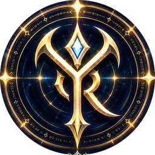
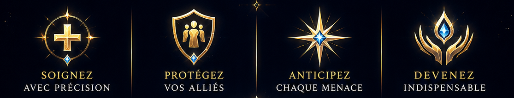

<h1 align="center">Lyorune</h1>

<em>The light that guides every healer</em>

<a href="https://github.com/BellaHealFr/Lyorune/releases/latest"><strong>Download</strong></a> ·
<a href="docs/SIGNALER_UN_BUG.md#reporting-a-bug-english">Report a bug</a> ·
<a href="README.md">Version française</a>

---

The tank who survives by a miracle. The mage who "just wanted to see". The heal that lands at the very last second, and the whole group breathing again. **Those are the moments we play healers for.**

Lyorune is a set of healing frames for **World of Warcraft: Forever**: your whole group in front of your eyes, all your spells under your fingers. You click, it heals. The rest of the time, you enjoy the dungeon, your friends and the journey.

Easy to set up, light in combat, pleasant to look at. I made it for everyone who loves watching over others.

<!-- captures:debut -->
<!-- captures:fin -->

## What Lyorune does for you

| | | |
|:-:|---|---|
|  | **Heal with one click** | Every mouse button, alone or with Shift, Ctrl, Alt, casts the spell of your choice on a player's frame. No targeting needed. |
|  | **Hover keys** | A keyboard key, an extra mouse button or the wheel casts a spell on the hovered frame. |
|  | **Everything at a glance** | Health, incoming heals, shields, healer mana, heals over time, debuffs, low health, threat, range. |
|  | **Dispel without searching** | The frame lights up when you can remove a magic effect, a curse, a disease or a poison. |
|  | **Resurrect with the same click** | On a dead player, your heal click casts your resurrection spell. Nobody stays on the floor. |
|  | **Your style** | Five themes, high contrast, transparency, size, sorting by group or by role, separate frames for tanks and pets. |
|  | **Test mode** | A fake group of 5 to 40 players to tune everything in peace. |
|  | **Announcements** | Low mana, mana restored, resurrection, with your own wording. |
|  | **Sharing** | Send your configuration to a friend, with a code or directly in game. |
|  | **Always at hand** | A button on the edge of the minimap opens the options or the test mode. You can move it, or remove it with a checkbox. |
|  | **Nothing is mandatory** | Every element has its checkbox, and a search box finds any setting. |

Lyorune never changes the game's frames or other addons' frames: it runs alongside ElvUI, Clique and your other interface addons.

## The runes of Lyorune

At the bottom of the options window, a line of golden runes lights up from time to time, from left to right.

**What they say:**

> *"Whomsoever takes up this blade shall wield power eternal."*

It is the inscription carved on Frostmourne's dais, the one Muradin reads to Arthas in Warcraft III. Everyone who grew up with Warcraft remembers it: the moment everything changes.

**How to read them:** each rune stands for one letter of the sentence. They are the runes of the Elder Futhark, a very real alphabet used almost two thousand years ago. The sounds "th" and "ng" are written with a single rune.

In game, hover the runes: they light up and their translation appears. If they distract you, a checkbox removes them (Help tab).

## Installation

1. Download the latest version from the [Releases](https://github.com/BellaHealFr/Lyorune/releases/latest) page.
2. Unzip it into `World of Warcraft\_forever_\Interface\AddOns\`. You should get a `Lyorune` folder.
3. Start the game. A one-minute tutorial opens on first login, and off you go.

## Getting started

No group at hand? Type `/lyorune test`: a fake group appears, with its wounded players and debuffs, so you can try your clicks and tune the look at your own pace.

| Command | Effect |
|---|---|
| `/lyorune` | Open the options |
| `/lyorune test` | Show or hide the fake group |
| `/lyorune tuto` | Restart the tutorial |
| `/lyorune verrou` | Lock or unlock the frames' position |
| `/lyorune bug` | Report a problem |

The options are available in English. The in-game tutorial and the player guide are currently in French only.

## Something wrong? Tell me

Every report makes Lyorune better for everyone. In game, type `/lyorune bug`, answer the three questions, copy the report (Ctrl+C) and paste it into the [English bug form](https://github.com/BellaHealFr/Lyorune/issues/new?template=bug_en.yml). Issues written in English are welcome. A step by step guide is in [docs/SIGNALER_UN_BUG.md](docs/SIGNALER_UN_BUG.md#reporting-a-bug-english).

## Compatibility

World of Warcraft: Forever, interface 16001. No dependency.

## Who am I?

I am **BellaDroode**, and I am in love with World of Warcraft: a magical world where loneliness has no place.

Lyorune grew out of that idea. Behind every health bar I see a companion, and healing means watching over them. I created this addon to keep that gesture simple, fast and beautiful.

If Lyorune travels with you in dungeons or raids, a star at the top of this page will always make my day. Have fun, and happy healing!

## License

Copyright © 2026 BellaDroode. All rights reserved.

You may use Lyorune and share it for free as is. You may not distribute a modified version, rename it, remove the author's name or sell it. The full text is in [LICENSE](LICENSE) (French, with an English summary).

**The code is visible, it is not free to reuse.** Like any World of Warcraft addon, Lyorune's code must stay readable by the players who install it; that grants no right to reuse it. If you see a renamed or modified copy of Lyorune, or one published under another author's name, please [report it](https://github.com/BellaHealFr/Lyorune/issues/new/choose).

World of Warcraft and Blizzard Entertainment are trademarks of Blizzard Entertainment, Inc. Lyorune is an independent project. The runic inscription in the options window quotes a line from Warcraft III, as a tribute.
