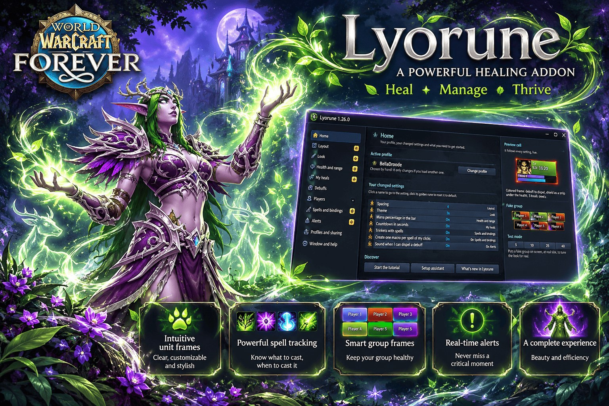
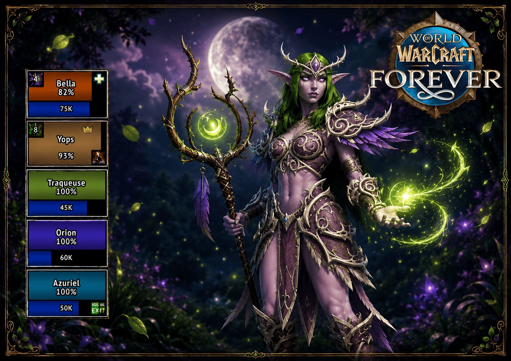
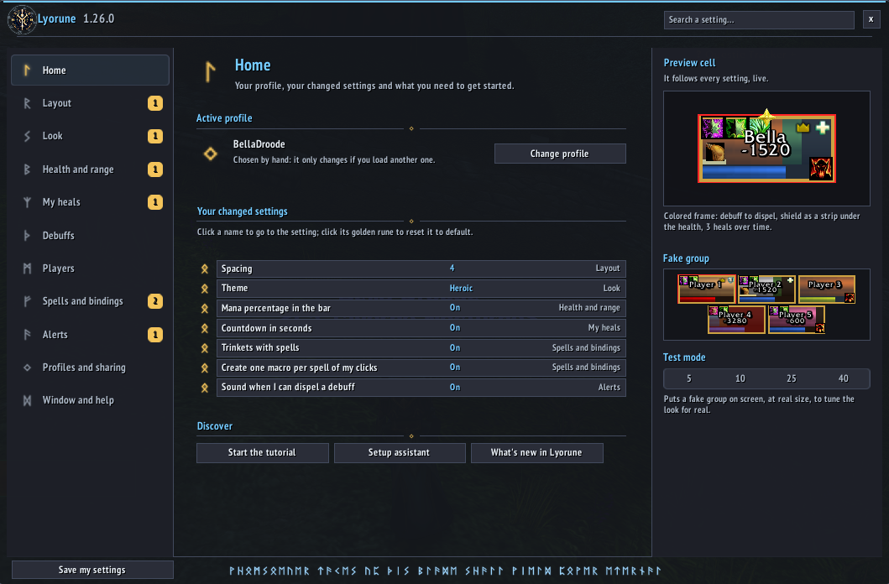

<p align="right"><a href="README.md">English</a> · <strong>Français</strong></p>

<p align="center"></p>

<h1 align="center">Lyorune</h1>

<p align="center"><em>La lumière qui guide chaque soigneur</em></p>

<p align="center">
<a href="https://github.com/BellaHealFr/Lyorune/releases/latest"></a>
<a href="https://github.com/BellaHealFr/Lyorune/releases"></a>
<a href="https://github.com/BellaHealFr/Lyorune/actions/workflows/tests.yml"></a>


<a href="https://discord.gg/uRaEPTGePu"></a>
</p>

<p align="center">
<a href="https://github.com/BellaHealFr/Lyorune/releases/latest"><strong>Télécharger</strong></a> ·
<a href="https://www.curseforge.com/wow/addons/lyorune-healing">CurseForge</a> ·
<a href="https://addons.wago.io/addons/lyorune">Wago</a> ·
<a href="https://www.wowinterface.com/downloads/info27323-Lyorune.html">WoWInterface</a> ·
<a href="https://bellahealfr.github.io/Lyorune/">Site</a> ·
<a href="docs/TUTORIEL.md">Guide du joueur</a> ·
<a href="docs/SIGNALER_UN_BUG.md">Signaler un bug</a> ·
<a href="README.md">English</a>
</p>

<p align="center"></p>

---

Le tank qui tient par miracle. Le mage qui a encore « juste voulu voir ». Le soin qui part à la dernière seconde, et tout le groupe qui respire. **C'est pour ces moments-là qu'on joue soigneur.**

Lyorune, ce sont des cadres de soin pour **World of Warcraft: Forever** : tout votre groupe sous les yeux, tous vos sorts sous les doigts. Vous cliquez, ça soigne. Le reste du temps, vous profitez du donjon, de vos amis et du voyage.

Simple à régler, léger en combat, agréable à regarder. Je l'ai fait pour tous ceux qui aiment veiller sur les autres.

<p align="center"></p>

## Ce que Lyorune fait pour vous

| | |
|:-:|---|
|  | **Soigner d'un clic** : chaque clic lance le sort et le rang de votre choix, sans cibler. |
|  | **Tout voir d'un coup d'œil** : vie, soins en route, boucliers, mana, menace et portée, même en combat ; les barres glissent en douceur. |
|  | **Dissiper sans chercher** : la case se colore quand vous pouvez retirer un affaiblissement. |
|  | **Relever sans changer de touche** : sur un joueur mort, votre clic de soin lance votre résurrection. |
|  | **À votre goût** : cinq thèmes, quatre formes de case, chaque élément placé à votre idée. |
|  | **Mode test** : un faux groupe de 5 à 40 joueurs pour tout régler tranquillement. |
|  | **Facile à régler** : douze chapitres et une case témoin qui montre chaque réglage en direct. |
|  | **Rien n'est obligatoire** : chaque élément a sa case à cocher. |

**[Toutes les fonctionnalités en détail](docs/FONCTIONNALITES.md)**

<!-- captures:debut -->
## En images

<table>
<tr>
<td width="50%" align="center"><br><em>Les cases de Lyorune : vie, mana, soins et rôle d'un coup d'œil</em></td>
<td width="50%" align="center"><br><em>Les options : chaque réglage a sa case à cocher</em></td>
</tr>
</table>
<!-- captures:fin -->
<!-- TODO: GIF clic-soin en action (5-10 s) -->
<!-- TODO: raid à 40 -->
<!-- TODO: JcJ -->
<!-- TODO: les 5 thèmes -->
<!-- Ces emplacements restent hors des lignes captures:debut / captures:fin, que outils/captures.py réécrit. Voir docs/images/captures/LISEZMOI.md. -->

## Ce qui rend Lyorune particulier

- **Des paladins qui s'entendent.** Les paladins qui ont Lyorune ne reprennent jamais la bénédiction d'un autre : chacun pose la sienne, sans en discuter.
- **Des druides à leur vrai rôle.** Un druide Restauration reste soigneur et un druide Équilibre reste DPS, même en forme de félin ou d'ours : Lyorune lit le rôle dans les talents et le partage avec les autres joueurs qui ont Lyorune.
- **Vos annonces de mana, même quand la mana est cachée.** Sur WoW Forever, la mana est cachée aux addons ; Lyorune annonce quand même votre mana faible et votre mana remontée.
- **Un carnet de soigneur.** Vos soins, résurrections et buffs réussis, par personnage, avec un bilan en sortant d'un donjon. Il reste sur votre ordinateur.
- **Un canal des soigneurs.** En français et en anglais, pour échanger entre soigneurs sur vos façons de jouer et vos spécialisations, si vous le voulez.
- **Prêt en une minute.** Aucune dépendance à installer, un tutoriel intégré dès la première connexion, et un mode test pour tout essayer sans groupe.
- **À côté de votre interface.** Lyorune ne touche à aucun cadre qui n'est pas le sien : il fonctionne avec ElvUI et Clique.

## Installation

1. Téléchargez la dernière version sur la page [Releases](https://github.com/BellaHealFr/Lyorune/releases/latest), sur [CurseForge](https://www.curseforge.com/wow/addons/lyorune-healing) (projet « Lyorune Healing »), sur [Wago](https://addons.wago.io/addons/lyorune) ou sur [WoWInterface](https://www.wowinterface.com/downloads/info27323-Lyorune.html), tous mis à jour en même temps. Ce sont les quatre seules sources officielles (voir [SECURITY.md](SECURITY.md)). Avec l'application CurseForge ou Wago, les mises à jour s'installent toutes seules. Lyorune peut aussi être installé et mis à jour avec un gestionnaire d'addons comme WowUp ; les quatre pages officielles restent les sources de référence.
2. Décompressez l'archive dans `World of Warcraft\_forever_\Interface\AddOns\`. Vous devez obtenir un dossier `Lyorune`.
3. Lancez le jeu. Un tutoriel d'une minute s'ouvre à la première connexion, et c'est parti.

Pour mettre à jour, remplacez le dossier `Lyorune` par celui de la nouvelle version. Vos réglages sont conservés.

## Prise en main

Pas de groupe sous la main ? Tapez `/lyorune test` : un faux groupe apparaît, avec ses blessés et ses affaiblissements, pour essayer vos clics et régler l'apparence à votre rythme.

| Commande | Effet |
|---|---|
| `/lyorune` | Ouvrir les options |
| `/lyorune test` | Afficher ou masquer le faux groupe |
| `/lyorune tuto` | Relancer le tutoriel |
| `/lyorune verrou` | Verrouiller ou libérer la position des cadres |
| `/lyorune bug` | Signaler un problème |
| `/lyorune nouveautes` | Voir les nouveautés, avec « Me montrer » pour aller au réglage |

Le guide complet pour les joueurs est dans [docs/TUTORIEL.md](docs/TUTORIEL.md).

## Questions fréquentes

**Mes clics ne lancent aucun sort.**
Vérifiez que « Laisser Clique ou le jeu gérer les clics » est décoché (chapitre Sorts et raccourcis, réglages fins de la partie Comportement) : coché, il coupe les clics de Lyorune. Un clic sans sort garde son rôle habituel : cibler le joueur ou ouvrir son menu.

**Le « clic pour lancer » du jeu prend le même clic que Lyorune.**
S'il utilise la même combinaison, il peut passer avant. Lyorune vous le dit une fois dans la discussion, et la ligne apparaît en orange dans le chapitre Sorts et raccourcis : changez la combinaison d'un côté ou de l'autre. Lyorune ne modifie jamais les raccourcis du jeu.

**Un de mes sorts n'est pas proposé.**
Tapez `/lyorune sorts` : Lyorune écrit dans la discussion les sorts qu'il propose, ceux de votre classe qui manquent et pourquoi (pas appris, autre spécialisation, passif), et ceux qu'il écarte. Un sort offensif n'est jamais proposé.

**La mana est cachée aux addons sur WoW Forever : les annonces de mana marchent-elles ?**
Oui. Les annonces de mana faible et de mana remontée partent quand même toutes seules : le seuil est approché par le coût de vos sorts, et la remontée mesurée pendant que vous buvez. Le liseré bleu de mana basse est calculé par le jeu lui-même : il marche en combat, même quand la mana est cachée.

**Mon annonce part dans le groupe au lieu de /dire.**
Hors des donjons et des raids, le jeu interdit à un addon d'écrire en /dire tout seul : l'annonce part alors dans le canal du groupe.

**Je n'arrive pas à déplacer mes cadres.**
Ils ne se déplacent jamais en combat. Hors combat, `/lyorune verrou` les libère (ou réglez « Déplacement des cadres », chapitre Disposition), puis faites glisser l'étiquette « Groupe ». `/lyorune reset` les remet au centre de l'écran.

**Le jeu ralentit en grand raid.**
Allumez « Mode performance » (chapitre Fenêtre et aide, réglages fins de la partie Aide) : la portée n'est plus revue qu'une fois par seconde, et rien ne disparaît de vos cases. `/lyorune mesure`, hors combat, montre le temps pris par Lyorune pour 5, 25 et 40 joueurs.

## Un souci ? Dites-le-moi

Chaque signalement rend Lyorune meilleur pour tout le monde. En jeu, tapez `/lyorune bug`, répondez aux trois questions, copiez le rapport (Ctrl+C) et collez-le dans le [formulaire de signalement](https://github.com/BellaHealFr/Lyorune/issues/new?template=bug.yml). Pour un défaut d'affichage, joignez une capture d'écran.

Première fois sur GitHub ? Le pas à pas est dans [docs/SIGNALER_UN_BUG.md](docs/SIGNALER_UN_BUG.md) : trois minutes, sans connaissance technique.

Une idée, une envie ? Le [formulaire d'idée](https://github.com/BellaHealFr/Lyorune/issues/new?template=idee.yml) est là pour ça.

## Limites connues

Elles viennent des règles du jeu, qui cachent certaines informations aux addons en combat :

- Les cadres ne se déplacent pas en combat, et un changement d'échelle attend la fin du combat.
- Un buff dissipé en plein combat se voit à la fin du combat (sauf votre buff unique, vu tout de suite).
- Si le groupe change en plein combat, vos buffs à reposer s'effacent des cases jusqu'à la fin du combat, le temps que Lyorune sache de nouveau qui est qui.
- En champ de bataille et pendant un boss, les buffs posés par un autre joueur restent inconnus : un buff dont Lyorune ne sait rien vous est proposé, mieux vaut une fois de trop que jamais.

## Compatibilité

| | |
|---|---|
| Jeu | World of Warcraft: Forever, interface 16001 |
| Langues | Français, anglais |
| Dépendances | Aucune. LibSharedMedia est utilisé s'il est présent, pour proposer vos textures. |
| Autres addons | Compatible avec ElvUI, Clique et les autres cadres de groupe : Lyorune ne touche à aucun cadre qui n'est pas le sien. |

## Documentation

| Document | Pour qui |
|---|---|
| [Guide du joueur](docs/TUTORIEL.md) | Utiliser et régler Lyorune ([English](docs/GUIDE.en.md)) |
| [Toutes les fonctionnalités](docs/FONCTIONNALITES.md) | Le détail de tout ce que fait Lyorune |
| [Signaler un bug](docs/SIGNALER_UN_BUG.md) | Le pas à pas, sans connaissance technique |
| [Journal des versions](CHANGELOG.md) | Ce qui change à chaque version ([English](CHANGELOG.en.md)) |
| [Feuille de route](docs/FEUILLE_DE_ROUTE.md) | Ce qui est prévu |
| [Notice de maintenance](docs/MAINTENANCE.md) | Comprendre et corriger le code |
| [Publication](docs/PUBLICATION.md) | Numérotation, sortie d'une version, suivi des demandes |
| [Guide de contribution](CONTRIBUTING.md) | Signaler, proposer, corriger |
| [Sécurité](SECURITY.md) | Ce que Lyorune fait de vos données |

## Contribuer

Les rapports de bug et les idées sont les bienvenus : voir [CONTRIBUTING.md](CONTRIBUTING.md).

Le projet est testé hors du jeu à chaque modification :

```
pip install lupa
python tests/run.py .
```

## Qui suis-je ?

Moi, c'est **BellaDroode**. Je suis un amoureux de World of Warcraft : un monde magique où la solitude n'a pas sa place.

Lyorune est né de cette idée. Derrière chaque barre de vie, je vois un compagnon de route, et soigner, c'est veiller sur lui. J'ai créé cet addon pour que ce geste reste simple, rapide et beau.

Si Lyorune vous accompagne en donjon ou en raid, une étoile en haut de cette page me fera toujours plaisir. Bon jeu, et bons soins !

## Venez jouer avec moi

Je joue au sein de la guilde **La Taverne Nocturne** : une guilde PvE détendue et francophone, qui part en raid après 22h. *Quand le monde s'endort, nos aventures commencent.*

Sur notre [serveur Discord](https://discord.gg/uRaEPTGePu), vous pouvez me retrouver pour discuter, jouer ensemble ou parler de Lyorune : une section lui est consacrée.

## Les runes de Lyorune

Au bas de la fenêtre d'options, une ligne de runes dorées s'illumine de temps en temps, de gauche à droite.

<p align="center"></p>

**Ce qu'elles disent :**

> *« Quiconque s'emparera de cette lame détiendra un pouvoir éternel. »*
>
> En version originale : *"Whomsoever takes up this blade shall wield power eternal."*

C'est l'inscription gravée sur le socle de Deuillegivre, celle que Muradin déchiffre pour Arthas dans Warcraft III. Tous ceux qui ont grandi avec Warcraft s'en souviennent : c'est l'instant où tout bascule.

**Comment les lire :** chaque rune vaut une lettre de la phrase anglaise. Ce sont les runes de l'ancien futhark, un alphabet bien réel, utilisé il y a près de deux mille ans. Les sons « th » et « ng » s'écrivent d'une seule rune.

En jeu, passez la souris sur les runes : elles s'éclairent et leur traduction apparaît. Et si elles vous distraient, une case à cocher les retire (chapitre Fenêtre et aide).

## Licence

Copyright © 2026 BellaDroode. Tous droits réservés.

Vous pouvez utiliser Lyorune et le partager gratuitement tel quel. Il est interdit d'en distribuer une version modifiée, de le renommer, de retirer le nom de son auteur ou de le vendre. Le texte complet est dans [LICENSE](LICENSE).

**Le code est visible, il n'est pas libre.** Comme pour tout addon de World of Warcraft, le code de Lyorune doit rester lisible par les joueurs qui l'installent ; cela ne donne aucun droit de le reprendre. Si vous voyez une copie de Lyorune renommée, modifiée ou publiée sous un autre nom d'auteur, merci de le [signaler](https://github.com/BellaHealFr/Lyorune/issues/new/choose).

World of Warcraft et Blizzard Entertainment sont des marques de Blizzard Entertainment, Inc. Lyorune est un projet indépendant. L'inscription runique de la fenêtre d'options cite une phrase de Warcraft III, en hommage.
