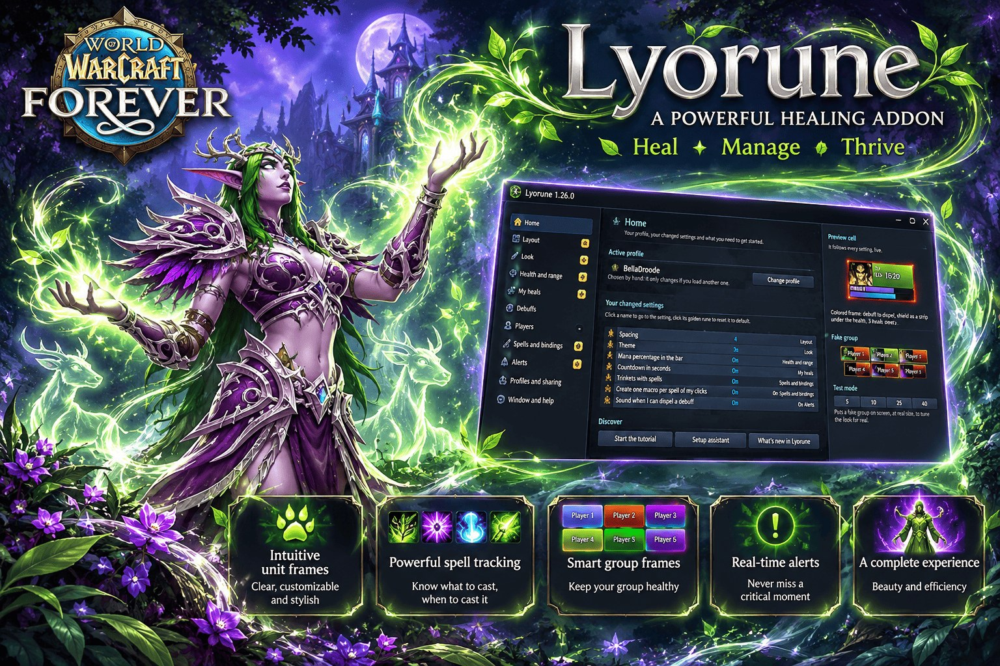
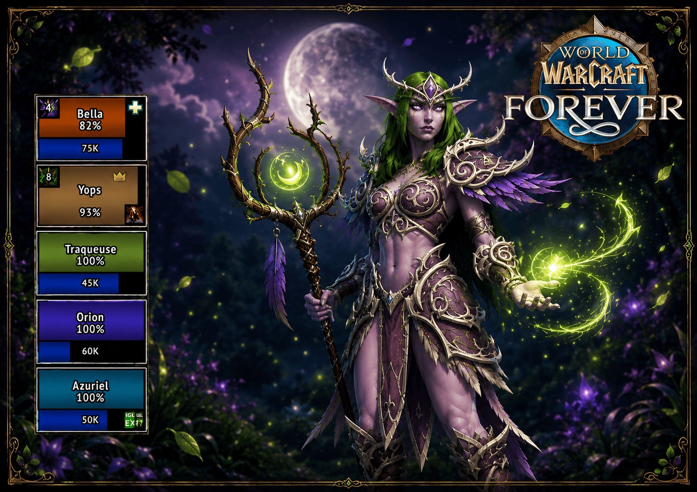

<p align="center"></p>

<h1 align="center">Lyorune</h1>

<p align="center"><em>La lumière qui guide chaque soigneur</em></p>

<p align="center">
<a href="https://github.com/BellaHealFr/Lyorune/releases/latest"></a>
<a href="https://github.com/BellaHealFr/Lyorune/releases"></a>
<a href="https://github.com/BellaHealFr/Lyorune/actions/workflows/tests.yml"></a>


</p>

<p align="center">
<a href="https://github.com/BellaHealFr/Lyorune/releases/latest"><strong>Télécharger</strong></a> ·
<a href="https://www.curseforge.com/wow/addons/lyorune-healing">CurseForge</a> ·
<a href="https://bellahealfr.github.io/Lyorune/">Site</a> ·
<a href="docs/TUTORIEL.md">Guide du joueur</a> ·
<a href="docs/SIGNALER_UN_BUG.md">Signaler un bug</a> ·
<a href="README.en.md">English</a>
</p>

<p align="center"></p>

---

Le tank qui tient par miracle. Le mage qui a encore « juste voulu voir ». Le soin qui part à la dernière seconde, et tout le groupe qui respire. **C'est pour ces moments-là qu'on joue soigneur.**

Lyorune, ce sont des cadres de soin pour **World of Warcraft: Forever** : tout votre groupe sous les yeux, tous vos sorts sous les doigts. Vous cliquez, ça soigne. Le reste du temps, vous profitez du donjon, de vos amis et du voyage.

Simple à régler, léger en combat, agréable à regarder. Je l'ai fait pour tous ceux qui aiment veiller sur les autres.

<p align="center"></p>

<!-- captures:debut -->
## En images

<table>
<tr>
<td width="50%" align="center"><br><em>Les cases de Lyorune : vie, mana, soins et rôle d'un coup d'œil</em></td>
<td width="50%" align="center"><br><em>Les options : chaque réglage a sa case à cocher</em></td>
</tr>
</table>
<!-- captures:fin -->

## Ce que Lyorune fait pour vous

| | | |
|:-:|---|---|
|  | **Soigner d'un clic** | Chaque bouton de souris, seul ou avec Maj, Ctrl, Alt, lance le sort de votre choix sur la case d'un joueur. Plus besoin de cibler. Un bijou peut partir avec le sort, un autre clic arrête l'incantation, et Lyorune vous prévient si le « clic pour lancer » du jeu prend la même combinaison. La touche de signal du jeu sur une case marque le joueur pour tout le groupe. Vos macros s'écrivent une fois dans Mes macros, puis se posent sur un clic ou se glissent dans une barre de sorts du jeu. |
|  | **Touches au survol** | Une touche du clavier, un bouton de souris supplémentaire ou la molette lance un sort sur la case survolée. |
|  | **Tout voir d'un coup d'œil** | Vie, soins en route, boucliers (en bande ou à la suite de la vie), absorption de soins, mana, mana basse des autres soigneurs et leur boisson quand ils boivent, soins sur la durée et affaiblissements (dessinés par le jeu : visibles en plein combat, tous les rangs de vos sorts ; vos sorts externes comme Infusion de puissance et Innervation ; Âme affaiblie en gris au bout de vos soins), auras privées des boss, gros défensifs des joueurs (Mur protecteur, Bouclier divin, Écorce...), joueurs étourdis, apeurés ou métamorphosés, invocation, vie basse, menace, portée en trois paliers, chef de groupe, temps de recharge global et incantation (barre ou anneau au curseur). Quand votre mana baisse, un liseré bleu doux borde l'écran ; après un sort payé en mana, un trait sur votre case compte les 5 secondes avant que la mana reparte. Hors combat, un panneau lance vos buffs manquants, Bouclier de terre du tank compris. |
|  | **Dissiper sans chercher** | La case se colore quand vous pouvez retirer une magie, une malédiction, une maladie ou un poison. Jusqu'à 3 affaiblissements à dissiper par case, le plus important d'abord. |
|  | **Relever sans changer de touche** | Sur un joueur mort, votre clic de soin lance votre résurrection. Personne ne reste au sol. |
|  | **À votre goût** | Cinq thèmes, contraste élevé, transparence, taille, quatre formes de case aux icônes rangées à leur mesure, chaque icône placée et agrandie à votre idée, rangement par groupe ou par rôle, cadres séparés pour les tanks et les familiers, joueurs épinglés à part, cases de la cible et de la focalisation. |
|  | **Mode test** | Un faux groupe de 5 à 40 joueurs pour tout régler tranquillement, sans déranger personne. |
|  | **Annonces** | Mana faible, mana remontée, résurrection, avec vos propres textes. Sur WoW Forever, où la mana est cachée aux addons, les annonces de mana faible et de mana remontée partent quand même toutes seules (seuil approché par le coût de vos sorts, remontée mesurée pendant que vous buvez). |
|  | **Profils et partage** | Un profil par taille de groupe, champ de bataille, arène et spécialisation, appliqué tout seul ; copie d'une seule partie d'un profil à un autre. Envoyez votre configuration à un ami, par un code ou directement en jeu. |
|  | **Toujours sous la main** | Un bouton au bord de la mini-carte ouvre les options ou le mode test. Il se déplace, et se retire d'une case à cocher. Dans les raccourcis du jeu, des touches au choix ouvrent les options, masquent les cadres, posent le prochain buff manquant ou lancent le mode test. |
|  | **Facile à régler** | Une fenêtre d'options en onze chapitres, avec une case témoin qui montre chaque réglage en direct pendant que vous le changez. Une rune d'or marque ce que vous avez modifié (un clic le rétablit), les réglages rares restent pliés, et une recherche retrouve n'importe quel réglage, jusque dans les explications. Une lumière de soin or et vert l'éclaire, et s'éteint d'une case à cocher. |
|  | **Rien n'est obligatoire** | Chaque élément a sa case à cocher : vous gardez seulement ce qui vous sert. |

Lyorune ne modifie aucun cadre du jeu ni des autres addons : il fonctionne à côté d'ElvUI, de Clique ou de vos autres addons d'interface.

## Les runes de Lyorune

Au bas de la fenêtre d'options, une ligne de runes dorées s'illumine de temps en temps, de gauche à droite.

<p align="center"></p>

**Ce qu'elles disent :**

> *« Quiconque s'emparera de cette lame détiendra un pouvoir éternel. »*
>
> En version originale : *"Whomsoever takes up this blade shall wield power eternal."*

C'est l'inscription gravée sur le socle de Deuillegivre, celle que Muradin déchiffre pour Arthas dans Warcraft III. Tous ceux qui ont grandi avec Warcraft s'en souviennent : c'est l'instant où tout bascule.

**Comment les lire :** chaque rune vaut une lettre de la phrase anglaise. Ce sont les runes de l'ancien futhark, un alphabet bien réel, utilisé il y a près de deux mille ans. Les sons « th » et « ng » s'écrivent d'une seule rune.

En jeu, passez la souris sur les runes : elles s'éclairent et leur traduction apparaît. Et si elles vous distraient, une case à cocher les retire (chapitre Fenêtre et aide).

## Installation

1. Téléchargez la dernière version sur la page [Releases](https://github.com/BellaHealFr/Lyorune/releases/latest) ou sur [CurseForge](https://www.curseforge.com/wow/addons/lyorune-healing) (projet « Lyorune Healing », mis à jour en même temps). Ce sont les deux seules sources officielles (voir [SECURITY.md](SECURITY.md)). Avec l'application CurseForge, les mises à jour s'installent toutes seules.
2. Décompressez l'archive dans `World of Warcraft\_forever_\Interface\AddOns\`. Vous devez obtenir un dossier `Lyorune`.
3. Lancez le jeu. Un tutoriel d'une minute s'ouvre à la première connexion, et c'est parti.

Pour mettre à jour, remplacez le dossier `Lyorune` par celui de la nouvelle version. Vos réglages sont conservés.

## Prise en main

Pas de groupe sous la main ? Tapez `/lyorune test` : un faux groupe apparaît, avec ses blessés et ses affaiblissements, pour essayer vos clics et régler l'apparence à votre rythme.

| Commande | Effet |
|---|---|
| `/lyorune` | Ouvrir les options |
| `/lyorune test` | Afficher ou masquer le faux groupe |
| `/lyorune tuto` | Relancer le tutoriel |
| `/lyorune verrou` | Verrouiller ou libérer la position des cadres |
| `/lyorune bug` | Signaler un problème |
| `/lyorune nouveautes` | Voir les nouveautés de la version |

Le guide complet pour les joueurs est dans [docs/TUTORIEL.md](docs/TUTORIEL.md).

## Un souci ? Dites-le-moi

Chaque signalement rend Lyorune meilleur pour tout le monde. En jeu, tapez `/lyorune bug`, répondez aux trois questions, copiez le rapport (Ctrl+C) et collez-le dans le [formulaire de signalement](https://github.com/BellaHealFr/Lyorune/issues/new?template=bug.yml). Pour un défaut d'affichage, joignez une capture d'écran.

Première fois sur GitHub ? Le pas à pas est dans [docs/SIGNALER_UN_BUG.md](docs/SIGNALER_UN_BUG.md) : trois minutes, sans connaissance technique.

Une idée, une envie ? Le [formulaire d'idée](https://github.com/BellaHealFr/Lyorune/issues/new?template=idee.yml) est là pour ça.

## Compatibilité

| | |
|---|---|
| Jeu | World of Warcraft: Forever, interface 16001 |
| Langues | Français, anglais |
| Dépendances | Aucune. LibSharedMedia est utilisé s'il est présent, pour proposer vos textures. |
| Autres addons | Compatible avec ElvUI, Clique et les autres cadres de groupe : Lyorune ne touche à aucun cadre qui n'est pas le sien. |

## Documentation

| Document | Pour qui |
|---|---|
| [Guide du joueur](docs/TUTORIEL.md) | Utiliser et régler Lyorune ([English](docs/GUIDE.en.md)) |
| [Signaler un bug](docs/SIGNALER_UN_BUG.md) | Le pas à pas, sans connaissance technique |
| [Journal des versions](CHANGELOG.md) | Ce qui change à chaque version ([English](CHANGELOG.en.md)) |
| [Feuille de route](docs/FEUILLE_DE_ROUTE.md) | Ce qui est prévu |
| [Notice de maintenance](docs/MAINTENANCE.md) | Comprendre et corriger le code |
| [Publication](docs/PUBLICATION.md) | Numérotation, sortie d'une version, suivi des demandes |
| [Guide de contribution](CONTRIBUTING.md) | Signaler, proposer, corriger |
| [Sécurité](SECURITY.md) | Ce que Lyorune fait de vos données |

## Contribuer

Les rapports de bug et les idées sont les bienvenus : voir [CONTRIBUTING.md](CONTRIBUTING.md).

Le projet est testé hors du jeu à chaque modification :

```
pip install lupa
python tests/run.py .
```

## Qui suis-je ?

Moi, c'est **BellaDroode**. Je suis un amoureux de World of Warcraft : un monde magique où la solitude n'a pas sa place.

Lyorune est né de cette idée. Derrière chaque barre de vie, je vois un compagnon de route, et soigner, c'est veiller sur lui. J'ai créé cet addon pour que ce geste reste simple, rapide et beau.

Si Lyorune vous accompagne en donjon ou en raid, une étoile en haut de cette page me fera toujours plaisir. Bon jeu, et bons soins !

## Venez jouer avec moi

Je joue au sein de la guilde **La Taverne Nocturne** : une guilde PvE détendue et francophone, qui part en raid après 22h. *Quand le monde s'endort, nos aventures commencent.*

Sur notre [serveur Discord](https://discord.gg/uRaEPTGePu), vous pouvez me retrouver pour discuter, jouer ensemble ou parler de Lyorune : une section lui est consacrée.

## Licence

Copyright © 2026 BellaDroode. Tous droits réservés.

Vous pouvez utiliser Lyorune et le partager gratuitement tel quel. Il est interdit d'en distribuer une version modifiée, de le renommer, de retirer le nom de son auteur ou de le vendre. Le texte complet est dans [LICENSE](LICENSE).

**Le code est visible, il n'est pas libre.** Comme pour tout addon de World of Warcraft, le code de Lyorune doit rester lisible par les joueurs qui l'installent ; cela ne donne aucun droit de le reprendre. Si vous voyez une copie de Lyorune renommée, modifiée ou publiée sous un autre nom d'auteur, merci de le [signaler](https://github.com/BellaHealFr/Lyorune/issues/new/choose).

World of Warcraft et Blizzard Entertainment sont des marques de Blizzard Entertainment, Inc. Lyorune est un projet indépendant. L'inscription runique de la fenêtre d'options cite une phrase de Warcraft III, en hommage.
