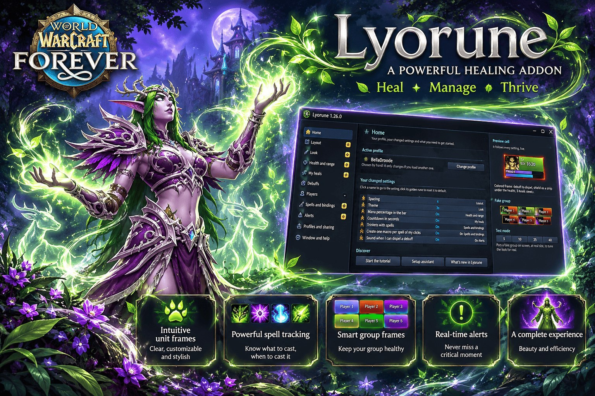
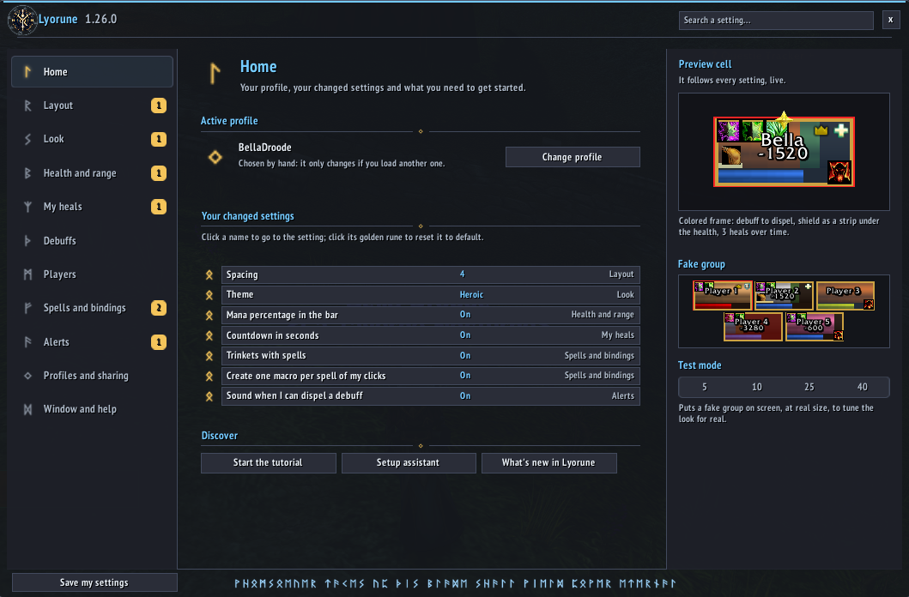

<!--
CurseForge (projet « Lyorune Healing », onglet Description, format Markdown) : texte à coller dans la description du projet. Mode d'emploi : LISEZMOI.md.
Résumé (champ « résumé / summary », 160 caractères au plus) :
  FR (138) : Cadres de soin pour WoW Forever : clic-soin au rang choisi, buffs manquants, dissipation et mana des soigneurs, en français et en anglais.
  EN (132) : Healing frames for WoW Forever: click-casting at the rank you choose, missing buffs, dispels and healer mana, in English and French.
Ordre : anglais d'abord, exigé par CurseForge (voir docs/PUBLICATION.md), puis français.
-->

**English first. Version française plus bas.**

# Lyorune: healing frames for World of Warcraft: Forever

*The light that guides every healer.*

Lyorune is a set of healing frames for World of Warcraft: Forever: your whole group in front of your eyes, all your spells under your fingers.

You click, it heals. The rest of the time, you enjoy the dungeon, your friends and the journey.

Easy to set up, light in combat, pleasant to look at. I made it for everyone who loves looking after others.

## What Lyorune does for you

- **Heal with one click**: every click casts the spell and rank of your choice, no targeting.
- **Everything at a glance**: health, incoming heals, shields, mana, threat and range, even in combat.
- **Dispel without searching**: the frame lights up when you can remove a debuff.
- **Resurrect with the same click**: on a dead player, your heal click casts your resurrection.
- **Your style**: five themes, four cell shapes, every element placed as you like.
- **Test mode**: a fake group of 5 to 40 players to tune everything in peace.
- **Easy to set up**: twelve chapters and a preview cell showing every setting live.
- **Nothing is mandatory**: every element has its checkbox.

[All features in detail](https://github.com/BellaHealFr/Lyorune/blob/main/docs/FEATURES.en.md)

## What makes Lyorune special

- **Paladins who get along.** Paladins who have Lyorune never cast another paladin's blessing again: each one casts their own, no discussion needed.
- **Your mana announcements, even when mana is hidden.** On WoW Forever, mana is hidden from addons; Lyorune still announces your low mana and your mana restored.
- **A healer's notebook.** Your successful heals, resurrections and buffs, per character, with a summary when leaving a dungeon. It stays on your computer.
- **A healers' channel.** In French and in English, where healers talk about how they play and their specialisations, if you wish.
- **Ready in a minute.** No dependency to install, a built-in tutorial from your first login, and a test mode to try everything without a group.
- **Alongside your interface.** Lyorune never touches a frame that is not its own: it works with ElvUI and Clique.

## Screenshots

*Lyorune frames: health, mana, heals and role at a glance*

*The options: every setting has its checkbox*

## Installation

1. With the CurseForge or Wago app, Lyorune installs and updates on its own.
2. By hand: unzip the archive into `World of Warcraft\_forever_\Interface\AddOns\`. You should get a `Lyorune` folder. Your settings are kept on every update.
3. Start the game: a one-minute tutorial opens on first login.

## Main commands

- `/lyorune`: open the options
- `/lyorune test`: show or hide the fake group
- `/lyorune tuto`: restart the tutorial
- `/lyorune bug`: report a problem

## Compatibility

- Game: World of Warcraft: Forever, interface 16001.
- Languages: English and French.
- Dependencies: none. LibSharedMedia is used if present, to offer your textures.
- Other addons: works with ElvUI and Clique. Lyorune never touches a frame that is not its own.

## Links

- [Source code on GitHub](https://github.com/BellaHealFr/Lyorune)
- [Player guide](https://github.com/BellaHealFr/Lyorune/blob/main/docs/GUIDE.en.md)
- [Report a bug](https://github.com/BellaHealFr/Lyorune/issues/new?template=bug_en.yml)
- [Discord (La Taverne Nocturne, Lyorune section)](https://discord.gg/uRaEPTGePu)
- [Website](https://bellahealfr.github.io/Lyorune/en/)

## Official sources

Lyorune is only published on four pages, updated at the same time: any other address may hold a modified copy (see SECURITY.md).

- [GitHub](https://github.com/BellaHealFr/Lyorune/releases/latest)
- [CurseForge](https://www.curseforge.com/wow/addons/lyorune-healing)
- [Wago](https://addons.wago.io/addons/lyorune)
- [WoWInterface](https://www.wowinterface.com/downloads/info27323-Lyorune.html)

On CurseForge, the project is called "Lyorune Healing"; in game, the folder and the addon name stay Lyorune.

## License

Copyright © 2026 BellaDroode, all rights reserved: you may use Lyorune and share it for free as is, without modifying, renaming or selling it.

---

# Lyorune : des cadres de soin pour World of Warcraft: Forever

*La lumière qui guide chaque soigneur.*

Lyorune, ce sont des cadres de soin pour World of Warcraft: Forever : tout votre groupe sous les yeux, tous vos sorts sous les doigts.

Vous cliquez, ça soigne. Le reste du temps, vous profitez du donjon, de vos amis et du voyage.

Simple à régler, léger en combat, agréable à regarder. Je l'ai fait pour tous ceux qui aiment veiller sur les autres.

## Ce que Lyorune fait pour vous

- **Soigner d'un clic** : chaque clic lance le sort et le rang de votre choix, sans cibler.
- **Tout voir d'un coup d'œil** : vie, soins en route, boucliers, mana, menace et portée, même en combat.
- **Dissiper sans chercher** : la case se colore quand vous pouvez retirer un affaiblissement.
- **Relever sans changer de touche** : sur un joueur mort, votre clic de soin lance votre résurrection.
- **À votre goût** : cinq thèmes, quatre formes de case, chaque élément placé à votre idée.
- **Mode test** : un faux groupe de 5 à 40 joueurs pour tout régler tranquillement.
- **Facile à régler** : douze chapitres et une case témoin qui montre chaque réglage en direct.
- **Rien n'est obligatoire** : chaque élément a sa case à cocher.

[Toutes les fonctionnalités en détail](https://github.com/BellaHealFr/Lyorune/blob/main/docs/FONCTIONNALITES.md)

## Ce qui rend Lyorune particulier

- **Des paladins qui s'entendent.** Les paladins qui ont Lyorune ne reprennent jamais la bénédiction d'un autre : chacun pose la sienne, sans en discuter.
- **Vos annonces de mana, même quand la mana est cachée.** Sur WoW Forever, la mana est cachée aux addons ; Lyorune annonce quand même votre mana faible et votre mana remontée.
- **Un carnet de soigneur.** Vos soins, résurrections et buffs réussis, par personnage, avec un bilan en sortant d'un donjon. Il reste sur votre ordinateur.
- **Un canal des soigneurs.** En français et en anglais, pour échanger entre soigneurs sur vos façons de jouer et vos spécialisations, si vous le voulez.
- **Prêt en une minute.** Aucune dépendance à installer, un tutoriel intégré dès la première connexion, et un mode test pour tout essayer sans groupe.
- **À côté de votre interface.** Lyorune ne touche à aucun cadre qui n'est pas le sien : il fonctionne avec ElvUI et Clique.

## En images

*Les cases de Lyorune : vie, mana, soins et rôle d'un coup d'œil*

*Les options : chaque réglage a sa case à cocher*

## Installation

1. Avec l'application CurseForge ou Wago, Lyorune s'installe et se met à jour tout seul.
2. À la main : décompressez l'archive dans `World of Warcraft\_forever_\Interface\AddOns\`. Vous devez obtenir un dossier `Lyorune`. Vos réglages sont conservés à chaque mise à jour.
3. Lancez le jeu : un tutoriel d'une minute s'ouvre à la première connexion.

## Commandes principales

- `/lyorune` : ouvrir les options
- `/lyorune test` : afficher ou masquer le faux groupe
- `/lyorune tuto` : relancer le tutoriel
- `/lyorune bug` : signaler un problème

## Compatibilité

- Jeu : World of Warcraft: Forever, interface 16001.
- Langues : français et anglais.
- Dépendances : aucune. LibSharedMedia est utilisé s'il est présent, pour proposer vos textures.
- Autres addons : compatible avec ElvUI et Clique. Lyorune ne touche à aucun cadre qui n'est pas le sien.

## Liens

- [Code source sur GitHub](https://github.com/BellaHealFr/Lyorune)
- [Guide du joueur](https://github.com/BellaHealFr/Lyorune/blob/main/docs/TUTORIEL.md)
- [Signaler un bug](https://github.com/BellaHealFr/Lyorune/issues/new?template=bug.yml)
- [Discord (La Taverne Nocturne, section Lyorune)](https://discord.gg/uRaEPTGePu)
- [Site](https://bellahealfr.github.io/Lyorune/)

## Sources officielles

Lyorune n'est publié que sur quatre pages, mises à jour en même temps : toute autre adresse peut contenir une copie modifiée (voir SECURITY.md).

- [GitHub](https://github.com/BellaHealFr/Lyorune/releases/latest)
- [CurseForge](https://www.curseforge.com/wow/addons/lyorune-healing)
- [Wago](https://addons.wago.io/addons/lyorune)
- [WoWInterface](https://www.wowinterface.com/downloads/info27323-Lyorune.html)

Sur CurseForge, le projet s'appelle « Lyorune Healing » ; en jeu, le dossier et le nom de l'addon restent Lyorune.

## Licence

Copyright © 2026 BellaDroode, tous droits réservés : vous pouvez utiliser Lyorune et le partager gratuitement tel quel, sans le modifier, le renommer ni le vendre.
